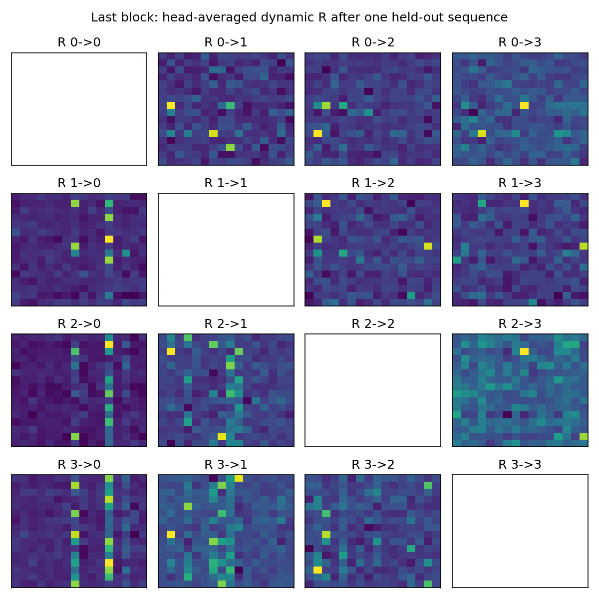

# v0.2: single-GPU optimization and synthetic retrieval experiment

This report extends, rather than replaces, the initial [reference validation](VALIDATION.md).
Source code, measured JSON files under `results/`, and reproduction commands
are included. No pretrained Qwen training job was stopped or modified.

## Implemented acceleration

1. **Pack scans** (`src/gpa/packed.py`). With equal slot widths, prepare the
   hierarchical lagged residuals, then batch every inner scan in `L*H` heads,
   every relation scan in `L*(L-1)*H` heads, and every outer scan in `L*H`
   heads. Four levels use **3**, not **20**, GDN calls per block. No edge is
   pruned and the recurrent/chunk definitions are unchanged.
2. **Fuse dense routing** (`src/gpa/triton_route.py`). One forward kernel
   combines source-edge softmax weights, message aggregation, centered
   variance normalization, tanh correction and slot softmax. An analytic
   backward computes base/message/edge-logit/gain gradients. Batch/time
   parameter partials are still reduced with PyTorch; neither this nor the
   GDN integration is claimed to be a single all-model kernel.
3. **Batch bridge projections**. Route MLP and both query paths use packed
   contractions rather than one independent Python projection chain per level.
4. **Static-shape CUDA Graph** (`src/gpa/training_graph.py`). Replay removes
   CPU dispatch gaps without deleting GPU work. Edge indices are registered
   nonpersistent buffers; allocating them from Python lists inside forward
   caused an actual capture failure and was fixed. Warmups do not update
   weights. Replays overwrite, not accumulate, leaf gradients; tests cover
   both parameters and input gradients. Shape changes require recapture.
5. **AMP correctness**. Explicit residual/bridge casts preserve BF16 Q/K/V
   with FP32 master parameters; otherwise parameter promotions can produce
   inconsistent types between levels. The FP32-master autocast case was
   tested on the GPU before retrieval training.

The fast path currently targets uniform per-level slot sizes and `chunk_size>1`.
Unequal capacities and tokenwise post-update residuals retain the reference
path. This work does not remove the documented lagged-block approximation.

## Measurement setup

One idle NVIDIA A100-SXM4-40GB; Python 3.11, PyTorch 2.9.0+cu128, Triton 3.5.0,
existing FLA checkout. No GPU workload ran concurrently with the timings.
BF16 projected Q/K/V and parameters, FP32 state, B=1, H=2, Dk=Dv=32,
four levels with M=16, block C=64. Timings include **forward and backward**,
but not optimizer, LM embeddings/FFN, first compilation, warmup, or capture.
Two timed-path warmups precede three measured iterations; graph creation has
its own three non-updating warmups. These are simple point measurements,
not a publication-quality multi-run speed study.

| Execution | T=256 | T=1024 |
|---|---:|---:|
| Original/reference schedule | 264.910 ms | 1260.982 ms |
| Packed scans | 139.209 ms | 551.367 ms |
| Packed + fused Triton route | 116.509 ms | 460.978 ms |
| Above + CUDA Graph | **10.421 ms** | **49.797 ms** |
| Single-level M=64, eager control | 46.547 ms | 179.274 ms |
| Single-level M=64, CUDA Graph control | 3.493 ms | 14.337 ms |

Raw timing, configurations, roundoff and profile summaries:
[`results/efficiency.json`](results/efficiency.json).

Do not attribute the full roughly 25x reduction to Triton fusion alone.
Without graph replay the reduction is about **2.27x / 2.74x**; most of the
additional graph gain removes dispatch gaps for thousands of small kernels.
The profiler measured a reference-pattern CPU-launch bottleneck, not solely
GDN arithmetic. At T=256 the fused eager profile still has ~3,625 launches;
its self CUDA time (~12.6 ms in the earlier profile) is much less than wall time.

The single-level control has equal **primary A/B/count capacity**, not equal
total state: the four-level cache has 14,464 elements versus 8,320 because
of dense R. The full model remains about **3.0–3.5x** slower than that
single-level graph control. This experiment does **not** establish speed parity.
Memory counters in the raw sequential benchmark also include retained graph
pools/anchors and are not isolated-model peak-memory comparisons.

## Numerical checks

* CPU double: forward, all relevant parameter gradients, input gradients and
  caches for 1/2/4 levels, three positional modes, packed vs reference.
* Custom Triton route: FP32 forward/backward checks at `(L,M)=(2,7),(4,16),
  (4,64),(8,128)`. Forward atol=2e-6/rtol=2e-5; derivative
  atol=2e-5/rtol=3e-4.
* Full BF16 packed-Triton model: Q/K/V gradients and arbitrary cached-call
  partitions checked against the packed torch reader; FP32 master autocast
  also passes.
* Graph replay: changed inputs alter gradients and repeated identical inputs
  do not accumulate gradients. A full GPA graph is tested, not just an MLP.
* Whole-core BF16 vs original schedule in the timing run: output relative L2
  error **0.40–0.45%**, Q/K/V gradient relative L2 errors **0.46–0.71%**.
  Graph replay retains those same results; it is not another approximation.

The expanded CPU run has **46 passed / 12 GPU-only skips**.
The final combined suite on the single A100 completed with **58 passed,
10 warnings, no skips**, in 215.15 seconds. The warnings are FLA's
time-first-layout heuristic for short remainders with many packed heads;
explicit shapes and cache parity were checked. The CPU and GPU counts are
separate runs, not disjoint tests to add together.

## Small mixed retrieval LM

This is a **randomly initialized small LM**, not the previously FineWeb-trained
Qwen checkpoint. GPA: width=128, two blocks, four heads, four 16-slot levels,
438,912 parameters. The control Transformer has the same width/depth and
causal depthwise short convolution (kernel 8), but **303,104** parameters;
it is not an equal-parameter benchmark. No Transformer attention is used in
the GPA model. Both receive the same synthetic training examples and budgets.

The vocabulary contains 256 synthetic symbols. Task mixture:

* 30% single key/value lookup;
* 30% two-token keys with random four-token identifier values;
* 20% MQAR (three non-repeating queries per example);
* 20% last-write-wins overwrite retrieval.

Values are sampled independently from 16 value symbols; tests use independent
record/answer streams, seed 900000 rather than training seeds 40000000+step.
Noise symbols/markers are explicit in the synthetic protocol. There is no
label-derived write mask or answer-dependent state update. No training or
test example is a predefined lookup table shared across splits.

The random identifier is only **four synthetic tokens**, not an actual UUID
string under a natural-language tokenizer. These results are not official
RULER NIAH1–3, MQAR benchmark-suite or BABILong results. Different lengths also
change the number of records, as recorded in the JSON.

### Initial 400-step run

AdamW lr=.002, gradient clip=1, B=8. First 100 steps: T=128/4 records;
next 300: T=256/8 records. Training uses `read_scale=8`, initial beta=.6,
initial decay=.0001; the default core instead uses 1/.1/.001. All are explicit
hyperparameters. Evaluation has 32 examples per task/length (MQAR 96 queries).

| T=256 task | GPA | Transformer |
|---|---:|---:|
| Single-value exact | 6.25% | 9.38% |
| Four-token identifier whole-query exact | 0% | 0% |
| MQAR per-query exact | 5.21% | 13.54% |
| Overwrite exact | 9.38% | 9.38% |

Raw: [`gpa_400.json`](results/gpa_400.json),
[`transformer_400.json`](results/transformer_400.json).
These weak scores are reported, not hidden. Both models are undertrained;
running a stable finite loss is not evidence of successful retrieval.
GPA's steady eager step was ~.22 seconds at B=8,T=256; initial compilation
made its first reported 20-step average ~11.8 seconds/step and must not be
confused with steady throughput.

### Diagnostic / curriculum follow-up

The 400-step diagnostic finds little token-type write selectivity in the
first block: outer beta is .587 for noise vs .604 for observed value tokens;
in the second block it is .583 vs .586. Final R's measured effective rank is
about 8.7–10.1 of 16, so **rank-one R collapse is not observed**. Weak write
selectivity is a candidate explanation, not a demonstrated causal result.

A follow-up starts both models from their own step400 weights, uses the
same additional steps/seeds, and progresses through 200 steps T64/1 record,
200 T128/2, 200 T128/4, then T256/8 through global step2000. No test samples
are mixed into training. GPA uses graph replay after correctness validation.
Both curriculum runs completed, with 64 held-out examples/task/length (192
MQAR queries). Training remained finite. The graph-trained small GPA LM took
about **.03 seconds/step** at B8,T256, versus ~.22 seconds/step in the initial
eager schedule. These include embeddings/FFN/optimizer and are not the same
measurement as projected-QKV core timings above.

## Curriculum results and a read-initialization pilot

The first curriculum run still substantially underperforms the Transformer.
A possible initialization mismatch is that outer GDN keys `slot=Ck` are
signed vectors, while the initial dominant query is a positive softmax route
with an independent random q projection. This is a hypothesis, not a proven
explanation of the gap.

An **optional, nondefault** `shared_query_center=True` parameterization tests:

```text
W_qs_effective = C^T/query_scale + Delta_W
q_out = route W_rs + q C^T + query_scale q Delta_W
```

The retrieval flag `--aligned-query` initializes `Delta_W=0` and
`W_rs=.02*(I-11^T/M)`. All state sizes, GDN writes, dense R edges and data
budgets remain the same. This is a **combined parameterization/initialization
pilot**, not a single-factor causal ablation. It independently starts from
the same original step400 weights, resets the changed matrices' optimizer
moments, and receives the same 1600-step curriculum. It does not inherit the
already curriculum-trained weights. It remains disabled by default because
the measured retrieval changes are mixed.

| Length / records | Query exact match | GPA independent q | GPA aligned-q pilot | Transformer |
|---|---|---:|---:|---:|
| 128 / 4 | single | 25.00% | 37.50% | 85.94% |
| 128 / 4 | identifier-4 | 1.56% | 0% | 53.13% |
| 128 / 4 | MQAR | 33.85% | 38.02% | 82.29% |
| 128 / 4 | overwrite | 28.13% | 21.88% | 78.13% |
| 256 / 8 | single | 15.63% | 17.19% | 60.94% |
| 256 / 8 | identifier-4 | 0% | 0% | 28.13% |
| 256 / 8 | MQAR | 27.08% | 24.48% | 61.46% |
| 256 / 8 | overwrite | 14.06% | 28.13% | 60.94% |
| 512 / 12 | single | 15.63% | 18.75% | 53.13% |
| 512 / 12 | identifier-4 | 0% | 0% | 20.31% |
| 512 / 12 | MQAR | 19.27% | 18.75% | 53.65% |
| 512 / 12 | overwrite | 14.06% | 14.06% | 56.25% |

Identifier whole-query exact equals free greedy-generation exact in these
checks; token accuracy is not substituted for it. T512 is an **extrapolation**
from maximum training length 256 and also has more records; it does not
isolate length at matched retrieval density. This is a small pilot: changes
of a few examples should not be declared significant architecture wins.

Raw: [`gpa_2000.json`](results/gpa_2000.json),
[`gpa_aligned_2000.json`](results/gpa_aligned_2000.json),
[`transformer_2000.json`](results/transformer_2000.json).

### Diagnostics and conclusion

After the independent-q curriculum, first-block outer beta is .450 on noise
vs .593 on value tokens; second-block beta remains .481 on both. Some slot
counts concentrate heavily (~65.5% in the largest second-block level-0
slot). R effective ranks remain about 7–8/16, not one. This suggests inspecting
write selectivity and slot utilization; it does not show that dense R caused
the deficit. A controlled comparison to the original count-normalized RSA
writer is still needed.

Head-averaged last-block R after one held-out sequence. Off-diagonal panels
are the full matrices; diagonal panels have no self-edge. Each panel uses
its own color scale: compare patterns, not cross-panel magnitudes.



Initial and aligned-pilot heatmaps are also bundled:
[`relation_before.png`](results/relation_before.png),
[`relation_aligned.png`](results/relation_aligned.png). Diagnostic JSON files
contain numeric write-rate and singular-value summaries.

**Conclusion:** execution, gradients, cache behavior and efficiency are
validated, but this new two-GDN approximation has **not** reproduced strong
retrieval or the earlier RSA system's quality. Stable training is not evidence
of equivalent retrieval, and the proposition references do not prove it.

## Reproduction

```bash
python -m pytest -q
python scripts/compare_efficiency.py --cuda-graph --output efficiency.json
python scripts/train_retrieval.py --steps 400 --output runs/gpa
python scripts/train_retrieval.py --attention transformer --steps 400 --output runs/transformer
python scripts/train_retrieval.py --resume runs/gpa/checkpoint-400.pt --steps 2000 \
  --easy-curriculum --cuda-graph --output runs/gpa_curriculum --eval-samples 64
python scripts/train_retrieval.py --attention transformer --resume runs/transformer/checkpoint-400.pt \
  --steps 2000 --easy-curriculum --output runs/transformer_curriculum --eval-samples 64
python scripts/analyze_retrieval.py runs/gpa_curriculum/checkpoint-2000.pt --plot
python scripts/train_retrieval.py --resume runs/gpa/checkpoint-400.pt --steps 2000 \
  --aligned-query --easy-curriculum --cuda-graph --output runs/gpa_aligned --eval-samples 64
```

`--plot` optionally needs matplotlib. Tests/capture use a free single card;
do not run a second timing or training process on that card concurrently.
CUDA Graph is for fixed-shape independent-document training/prefill, not a
general variable-shape generation-cache adapter. Checkpoints, optimizer
states, machine addresses and private logs are not bundled in the release.
