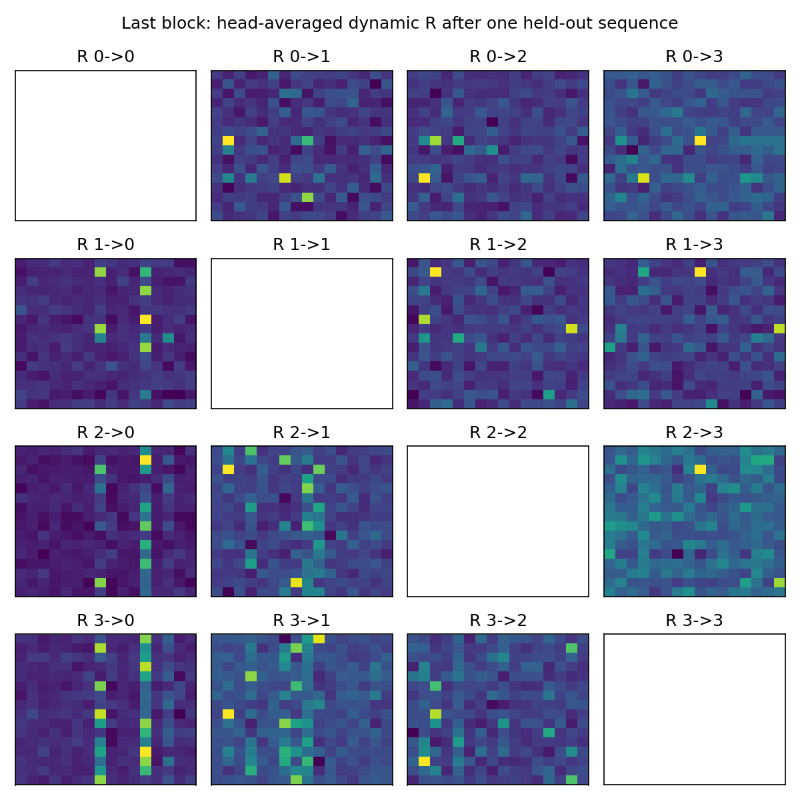

# GPA v0.2 单卡测试、融合与检索实验

结论：**代码、梯度和缓存已跑通，效率明显提升；但新两阶段 GDN 近似的检索质量
仍未达到 Transformer 对照，也不能宣称复现了之前 RSA 的质量。**

## 正确性与实现

使用开发机空闲的单张 A100 40GB，未停止或修改现有 Qwen 训练。
环境为 PyTorch 2.9.0+cu128、Triton 3.5.0 和现有 FLA checkout。

* 单卡整套 `pytest`：**58 passed，无跳过**；10 条为 FLA 短序列/打包多头的布局提示。
* CPU 独立验证：46 passed、12 GPU-only skips。两个数字不是相加后的测试数。
* 覆盖五命题参考、GDN 公式、可学习初始状态梯度、任意缓存切段、前后向、四/八级与大 slot、
  稠密 R 反向、FP32 主参数＋BF16 autocast、CUDA Graph 重放不累积旧梯度。

实际新增加速：

1. `packed.py`：各级 inner/outer 和所有 R 边分别并入 head 维，四级每块从 20 次 GDN scan
   调用减少为 3 次；没有删边、减少状态或改 chunk 边界。
2. `triton_route.py`：稠密入边加权、归一化、tanh 修正、route softmax 融成一个前向核，
   有显式反向；参数梯度的 batch/time 归约仍用 PyTorch。
3. bridge 投影按级/头打包计算。
4. `training_graph.py`：固定形状前后向的 CUDA Graph。边索引改为 buffer，避免前向 CPU→GPU
   临时拷贝导致 capture 失败。图捕获与 warmup 不更新权重，重放不会累加上次梯度。

## 效率

下表为 attention core **前向＋反向**，不是完整 LM：B=1、H=2、D=32、4×16 slots、
chunk=64。首次编译、warmup、capture、optimizer 和 FFN 均不计入；每项 3 次计时。

| 序列长度 | 原参考调度 | 打包＋Triton 融合 | 再加 CUDA Graph |
|---|---:|---:|---:|
| 256 | 264.91 ms | 116.51 ms | **10.42 ms** |
| 1024 | 1260.98 ms | 460.98 ms | **49.80 ms** |

不带 Graph 的提速约 **2.3–2.7 倍**；合计约 25 倍的收益主要还包含消除大量 CPU 调度间隙，
不能全部归给 Triton 融合。BF16 相对原调度输出误差约 0.40%–0.45%，输入梯度误差约 0.46%–0.71%。

单级 M=64 的 Graph 对照为 3.49 / 14.34 ms，本版仍慢约 3–3.5 倍，**未实现同速**。
它们仅主 A/B/count 容量相同：四级加了完整稠密 R，总缓存 14,464 elements，单级为 8,320。
原始数据及 profiler 在 [efficiency.json](results/efficiency.json)。

## 混合合成检索训练

从随机权重训练 width=128、两层、4 heads 的小 LM。GPA 为 438,912 参数；Transformer
对照为 303,104 参数，宽度/层数/短卷积相同，但不是严格等参数对照。
此次没有 FineWeb 或 Qwen 权重，不能外推为已有 Qwen 的检索结果。

数据为四类纯合成任务混合：单值检索 30%、随机四 token 标识符 30%、MQAR 20%、覆盖更新 20%。
训练/测试记录和答案独立随机生成；只在答案位置计算 causal next-token CE。没有依据答案标签
设置写入 mask。“四 token 标识符”**不是官方 RULER NIAH3 的自然语言 UUID**。

两者先训练 400 步，再分别从自己的 step400 权重增加相同的 1600 步课程训练：
T64/1 条→T128/2 条→T128/4 条→T256/8 条，总计约 327.68 万输入 tokens。
数据、步数、种子一致；测试每任务/长度 64 个独立样本，MQAR 为 192 个 query。
训练使用 read_scale=8、beta_init=.6、decay_init=.0001、lr=.002、grad clip=1。

| 256 tokens / 8 条记录 | GPA | Transformer |
|---|---:|---:|
| 单值 query 全对 | 15.63% | 60.94% |
| 四 token 标识符整串全对 | **0%** | 28.13% |
| MQAR query 全对 | 27.08% | 61.46% |
| 覆盖更新 query 全对 | 14.06% | 60.94% |

128 tokens 下 GPA 单值为 25%、标识符整串为 1.56%；512 的结果仅为外推，不能当作同长度训练结果。
小样本与短训有明显限制，但目前数据也不能支持“两阶段近似与原版检索等效”的结论。

## 诊断与一次附加对照

原训练后，第一层 outer beta 在噪声 token 上约 .450、值 token 上约 .593；第二层二者均约 .481。
一些 soft count 集中到单个 slot（最大约 65.5%）。R 有效秩约 7–8/16，**没有观察到秩一塌缩**。
这些数值提示关注写入选择性、slot 利用率，但尚不是因果证明。



图中对角位置没有自连接；每个子图独立色标，只用于比较结构而非跨图比较幅值。

另测 query 对齐：

```text
q_out = route W_rs + q C^T + (q/16) Delta_W
Delta_W 初始化为 0
W_rs 初始化为 .02*(I-11^T/M)
```

这相当于参数化 W_qs=16*C^T+Delta_W，让 query 的初始投影与 slot=Ck 对齐。它从同一个
原始 step400 独立出发，重置改动矩阵的 optimizer moments，接受相同课程与预算，没有继承
已完成课程训练的权重。它同时改参数化和初始化，不能据此分离各自贡献。

结果并不一致：256 下单值 17.19%、MQAR 24.48%、覆盖更新 28.13%、标识符整串仍为 0%；
因此只作为可复现实验开关，**没有改成默认配置，也不将其称为修复成功**。

完整 128/256/512 表格、所有 JSON、复现命令在 [英文完整报告](OPTIMIZATION.md)。
后续优先应对比原始计数归一化 RSA 写入与两阶段 GDN 写入，并检查选择性/槽利用率；
不建议仅凭工程测试通过，就直接将此近似替换进之前表现良好的大模型训练。
