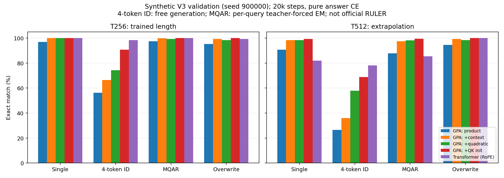
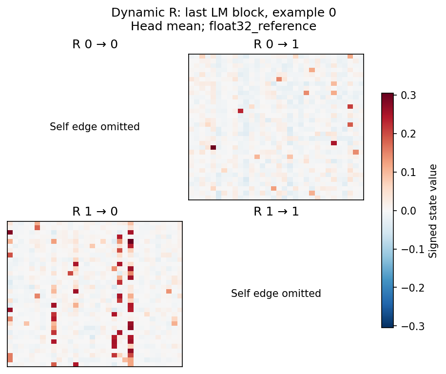
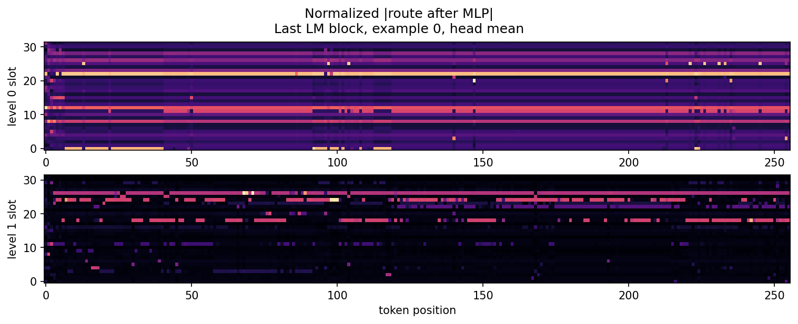

# GPA v0.3 单卡检索与加速报告

这轮保持 **30% 单值检索、30% 随机四 token 标识符、20% MQAR、20% 覆盖更新**，
只用答案位置的 next-token CE。从随机初始化训练，不从已经会检索的权重迁移，
不加入 key 对齐辅助损失，也不向模型提供写入位置或答案掩码。

当前最优小模型已接近本轮 Transformer 对照，但标识符整串检索仍未到 100%。
实现更新了 RSA 的存储控制和关系写入，同时保留 GPA 的全连接稠密读取；
没有套用 RSA 相邻级/R32 稀疏读取。另完成相同模型的分级调度与反向加速。

## 1. 独立测试：主要结论

模型选择只使用 seed900000 验证流，选定 `paired_temporal_v3` 后才测试 seed920000。
以下每项 256 条独立样本；MQAR 每条三问，共 768 问。训练长度 T256/8 records。

| 测试长度 / records | 模型 | 单值 | 四 token ID 整串生成 | MQAR 每问 / 整条三问全对 | 覆盖更新 |
|---|---|---:|---:|---:|---:|
| 128 / 4 | GPA | 100% | 97.66% | 100% / 100% | 100% |
| 128 / 4 | Transformer | 100% | 97.27% | 100% / 100% | 98.83% |
| **256 / 8** | **GPA** | **100%** | **93.36%** | **100% / 100%** | **100%** |
| **256 / 8** | **Transformer** | **100%** | **96.09%** | **100% / 100%** | **100%** |
| 512 / 12，外推 | GPA | 100% | 72.66% | 99.61% / 98.83% | 100% |
| 512 / 12，外推 | Transformer | 86.33% | 79.69% | 85.16% / 58.98% | 99.61% |

T256 的四 token ID 相差 **2.73 个百分点**，其他三项本次样本全对。
T512 同时增加距离与记录数，是外推，不是 T512 训练成绩。GPA 在部分任务更稳，
标识符仍落后；不能据此宣布全面胜出或统计等价。该任务是有限词表的结构化合成检索，
**不是官方 RULER NIAH3，也不是真实自然语言 UUID/BABILong 测试**。

GPA 为 **493,816 参数**，Transformer 为 **303,104 参数**；两者 width128、heads4、
两个 LM block，同样的 QKV 短卷积、FFN、数据与优化器日程。GPA 每 head 两级 slot32，
Q/K/V 维度32，chunk64，无显式 RoPE；Transformer 使用标准因果 SDPA 与 RoPE。
这属于同宽同深对照，不是严格等参数对照。额外宽模型与改过初始化的 Transformer
对照也保留在原始结果中，没有用较差对照替换上述主要对照。

曾额外设定“验证每项至少95%且距对照不超过5个百分点”的内部目标。选定 GPA 的验证
ID EM 是90.625%，因此 `selection.json` 的 `validation_target_met=false` **仍然保留**。
独立结果更高，不用于追溯改写验证门槛。

## 2. 具体改动与存储、读取公式

以下省略 batch/head，下标 t 是 token，i 是存储级。列向量约定：
`A_i∈R^(Dk×M_i)`，`B_i∈R^(M_i×Dv)`，`R_ij∈R^(M_i×M_j)`，`n_i∈R^M_i`。
各级 A/B 起始状态可学习且非零，R 起始为可学习零矩阵，n 从零开始累计。

### 输入特征和控制

LM 的 Q/K 先经过因果 depthwise conv8 与 SiLU，V 经同类卷积。选定模型再使用共享
非线性角特征；设 `unit(x)=x/max(||x||,eps)`，逐元素乘记为 ⊙：

```text
u = unit(x)
a = 2 sigmoid(a_raw)                    # 初始 .25
Phi(x) = sqrt(||x||²+1e-12) unit(u + a sqrt(Dk) (u U) ⊙ (u V))
q = Phi(q); k = Phi(k)                  # Q/K 共用 U,V；value 不变
c_t = SiLU(DWConv8(LN(hidden))_t)       # 独立的因果写控制输入
[gi, bi, go, bo] = control_i(c_t)
g_i^a = -tier_i min(softplus(gi),10)
g_i^b = -tier_i min(softplus(go),10)
beta_i^a = .9 sigmoid(bi); beta_i^b = .9 sigmoid(bo)
```

两级 tier 为1、.1；四级为1、.1、.01、.001。门是每 token/head/level 的标量，
不混淆 vector gate 的状态轴。初始 beta=.6、decay=1e-4。控制器只看普通因果 hidden，
不会接收解析后的记录/答案角色。

### 两阶段状态和层级残差

定义 key-major GDN 更新（k 为归一化 key，v 不归一化）：

```text
D(S,k,v,g,beta) = exp(g) S
                  + beta unit(k) [v - (exp(g) S)^T unit(k)]^T
slot_i = C_i k_i                        # 线性投影；不是 log-sigmoid/expm1
p_i = softmax(slot_i/.25)
A_t^i = D(A_(t-1)^i, k_i, slot_i, g_i^a, beta_i^a)
B_t^i = D(B_(t-1)^i, slot_i, v_i, g_i^b, beta_i^b)
n_t^i = n_(t-1)^i + p_i
eta_i^K,V = 1 + .25 tanh(raw_i^K,V)
k_(i+1) = k_i - eta_i^K A_frozen^i p_i
v_(i+1) = v_i - eta_i^V (B_frozen^i)^T p_i
```

`frozen` 是本 chunk 开始时的状态，不是本 token 更新后的状态。这是明确的固定分块
滞后残差模型，不能宣称等价于逐 token 的 post-update 残差。cache 保存 chunk offset
与 frozen 快照，任意外部切分都保持同一分块边界。A 是 delta 状态表示的重构，
不是精确计数均值；另一个 `PaperDenseGPA` 才显式维护计数归一化的 key/value 均值。

### 关系矩阵：继承 RSA 的规范化修正，扩展到所有有向级对

对每个 `i≠j` 都维护完整动态 R，包括高层到低层；没有低秩因子、邻接裁剪或 top-k。

```text
r_i = sqrt(sum(p_i²)+1e-6)
beta_R = min(sigmoid(rho_ij) r_i², .9)
g_R = -softplus(decay_raw_ij)
R_t^ij = D(R_(t-1)^ij, p_i, p_j/r_i, g_R, beta_R)
```

修正 beta/value 是因为 GDN 内部会归一化 key。若忽略它，近均匀的 p 也会像尖峰
assignment 一样以很大步幅覆写关系。忽略 eps 且未触顶时，上式约为
`exp(g)R + sigmoid(rho) p_i[p_j-(exp(g)R)^T p_i]^T`。
保留 eps 的实际代码不宣称与 eps=0 的表达逐位相等。所有写入都不依赖 q。

### 稠密兼容度乘积读取

```text
base_i = 8 A_t^i^T unit(q) + softplus(count_gain_i) log(1+n_t^i)
e_i = softmax(base_i)
m_ij = (R_t^ij)^T e_i                  # GDN 查询归一化后恢复 ||e_i||
w_ij = softmax_over_sources(edge_logit_ij)
G_j = exp(clamp(relation_gain_j,-4,4))
route_j = softmax(base_j + M_j G_j sum_(i!=j) w_ij m_ij)
```

等价于以 `exp(m_ij)` 为正兼容度势的加权乘积，再与本级 evidence 相乘、归一化。
它参考论文中的关系传输/乘积读取，但不是声称 GDN 的有正有负 R 本身就是概率表，
也不是证明与论文所有计数模型公式严格相等。所有入边同步聚合；没有“前级指导后级”
的读取反馈。选定模型只有两级，因此同时包含0→1与1→0；多于两级的同一实现保持所有
有向级对。四级/八级的 route 前后向另有 CUDA 形状覆盖。

随后完成 MLP、route/query 双通道定标和第二阶段读取：

```text
r_j = route_j + gain_j GELU(route_j U_j) V_j
r_j = r_j / clamp(sum(abs(r_j)), .25, 4)
u_j = W_rs_j^T r_j
d_j = W_qs_effective_j^T q / 16
W_qs_effective_j = C_j^T / (1/16) + learned_delta_j  # delta 初始0
z_j = .1 + .8 sigmoid(mix_raw_j)
qout_j = z_j unit(u_j) + (1-z_j) unit(d_j)
o_j = (B_t^j)^T unit(qout_j)
o = sum_j softmax(level_output_logits)_j o_j
```

上面的 W 方向沿用代码中行向量右乘习惯，`W_qs_effective` 形状为 Dk×M。
分母 clamp 不意味着任意巨大 MLP 输出都具有全局 L1 上界。
双通道各自先归一化，避免原先 direct 分支数十倍幅值压住状态 route。

### 通用 Q/K 卷积初始化

原卷积接近当前 token 恒等。新初始化让每 head 一半 Q/K 通道先池化窗口
（每 tap `1/sqrt(8)`），另一半用交错的单延迟 tap。所有权重继续学习；
V 保持当前 token 通路。该改动增加上下文/顺序初始可辨识性，**不增加参数或推理操作**，
不按 token ID、key 位置或答案位置设计。它对随机四 token ID 训练帮助最大。

对应实现：`attention.py` 的 `_gates/_relations/_bridge`，`features.py`，
`retrieval.py` 的控制卷积与初始化，`packed.py`，`triton_route.py`。
更详细的备选模型公式见 [DENSE_V3.md](DENSE_V3.md)。

## 3. 各项改动的实测收益

下表是 **同一验证流** seed900000、每项128条，均20k步，不与独立测试混算。
同一个训练随机种子的小样本探索，未做多种子置信区间；顺序增益不是严谨的独立因果归因。

| 顺序实验 | 单值 | ID 整串 | MQAR 每问 | 覆盖更新 | ID 较上项变化 |
|---|---:|---:|---:|---:|---:|
| 更新后的配对写入＋稠密 product read | 96.88% | 56.25% | 97.40% | 95.31% | — |
| ＋双通道归一化定标 | 98.44% | 58.59% | 99.22% | 98.44% | +2.34 pp |
| ＋因果上下文写控制 | 100% | 66.41% | 99.74% | 99.22% | +7.81 pp |
| ＋共享 Q/K 二次角特征 | 100% | 74.22% | 99.22% | 98.44% | +7.81 pp |
| ＋通用 Q/K 时间卷积初始化 | 100% | **90.63%** | **100%** | **100%** | **+16.41 pp** |
| 原同宽同深 Transformer＋RoPE | 100% | 98.44% | 100% | 99.22% | — |

不应把 56.25→90.63% 全归于一个公式。单独的“只换 R 写法”没有严格旧版 V3 对照，
不凭历史不同数据版本的结果虚构收益。原始所有配置、预算和结果保存在
[summary.json](results/v3/summary.json) / [表格](results/v3/summary.md)。



以下没有超过最佳模型，保持可选，不推荐默认打开：

| 备选改动 | T256 验证 ID EM | 结论 |
|---|---:|---|
| 关系边际频率修正 | 62.50% | 没有优于相应结构探索后的最佳值 |
| 上下文输出门 | 64.06% | 低于二次特征方案 |
| 四级16 slots，同总主状态容量 | 75.78% | 低于两级32 |
| key_dim64、slot32 | 82.81% | 额外 key 容量未胜出 |
| 可学习读取温度 | 89.06% | 接近但未超过固定8 |
| 两级64 slots、key_dim64 | 82.81% | 扩容至107万参数仍未胜出 |
| width256、四 LM block | 62.50% | 扩模型本身不保证检索改善 |

显式计数均值/两次 transport 备选模型也实现并验证了梯度，但总体检索明显较差；
早期 V2 覆盖更新高分带有“只需取最后一条记录”的捷径，**不作为成功证据**。
主结果统一 V3：更新四个不同 key，随机问其中一个，且强制新旧 value 不同。

## 4. 效率：相同数学模型改调度

旧调度每个时间 chunk 分别调用 inner / 全关系 / outer，共约 `3 ceil(T/64)` 次 GDN。
新 `execution=staged` 先逐级扫描全序列，并在真实块后插入零更新的 identity query probe
暴露块末状态，用上一块快照计算下级残差。最后统一完成全关系、route 与实际 outer 读取，
为 `L+2` 次全序列 GDN。probe 的 gate=0、beta=0、key/value=0，不改变记忆、计数、位置。
probe 的状态梯度通过 GDN 正常反传，不 detach。

它沿用同一滞后残差定义，没有换成近似更粗的模型。代价是额外 probe 算量和临时激活，
不是“零开销”，也不是把全模型变成一个 Triton kernel。自定义 Triton 已覆盖 dense route
聚合/softmax 前后向；GDN 使用公开 FLA Triton，其他投影在同一 CUDA Graph 中执行。

A100-SXM4-40GB、B8、BF16、同一已训练权重。计时包含前向答案 CE、反向、clip1、
fused AdamW(lr=0)；不含编译、预热、图捕获、生成数据、打印、IO。
lr=0 保持权重相同，同时执行实际优化器 kernel。每项10次稳态迭代。

| 长度 | 原 GPA＋Graph | staged GPA＋Graph | 提速 | Transformer＋Graph |
|---|---:|---:|---:|---:|
| 256 | 21.02 ms | 10.56 ms | **1.99×** | 2.38 ms |
| 1024 | 74.62 ms | 26.46 ms | **2.82×** | 11.50 ms |
| 4096 | 302.36 ms | 105.02 ms | **2.88×** | 131.56 ms |

当前 GPA 仍比短序列 Transformer 慢，不能声称普遍同等吞吐。
T4096 在这套实现/默认 SDPA 后端选择下快于该对照，但没有核定最优 FlashAttention
配置，不能声称超过最优 Transformer 实现。T1024/T4096 是速度测试，
不代表这些长度已经训练或检索达标。
T256 的新旧 logits 相对 L2 为0.019%，参数梯度相对 L2 为0.287%；
T1024 分别0.059%、0.504%。CPU double 的调度一致性、全状态及梯度比较另有严格测试。
不匹配维度、位置矩模式或不足四块时保留原路径；任意部分块 cache 也保持原语义。

详细机器、版本、源文件指纹见 `results/v3/runtime_final.json`，原始稳态测量见
[efficiency_lm_staged.json](results/v3/efficiency_lm_staged.json)。
4096 补充记录见 [efficiency_lm_4096.json](results/v3/efficiency_lm_4096.json)。

## 5. 正确性、诊断与复现

本地 CPU 全套 **85 passed、31 CUDA-only skipped**。单 A100 最终检查、加速版独立
回归结果与4096速度补充见 [VALIDATION_V3.md](VALIDATION_V3.md)。
测试覆盖五个命题参考、各状态方向、可学习前缀、cache 任意切分、前缀因果性、
Q/K/V/control/参数/最终状态的梯度，以及多种 L/M 的 dense route Triton 前后向。
整个 attention cache 的检查不等于本 tiny LM 已接入 HF `generate/use_cache`；
当前评估器通过重新计算前缀生成答案，短卷积整 LM 的增量缓存适配不在本轮范围内。

诊断输出真实 route、gate/beta 统计、R 热力图/有效秩、分支范数及移除 R **读取**的消融；
移除读取时仍保留所有写入。角色标签只用于推理后分组统计，从不输入控制器。
一次小批诊断变化不能替代全测试集消融。图与数值保存在 `results/v3/diagnostics_final*`。

本次选定权重的8条 ID 样本、32个答案预测上，移除 R 读取前后 token 准确率均100%，
**没有预测改变**。因此，不能把整体提升归因于稠密 R，也不能声称已经证明 R 优于稀疏读取。
R 的平均有效秩在两个 LM block 分别为17.82、12.46，说明它并非简单 rank1；
“有较高秩”不等于“对检索有效”。更大测试集的 R 消融仍未做。

第一个 LM block、存储 level0 的 outer beta：噪声约 .048、记录 value 约 .264、
答案中的 value 约 .023，符合学习到选择性写入的现象；第二个 block 同级 beta
整体约 .003，写入很弱。平衡前 direct/route 范数比约12–26倍，支持分支定标的动机。
这些是推理后的观察，不是模型输入或额外损失。

下面用同一权重/样本在 CPU FP32 参考路径重新绘图，避免将绘图与 CUDA 初始化绑定；
数值与 GPU BF16 有舍入差异。原始 GPU 诊断 JSON 仍保留，CPU 也得到相同的消融预测。
绘图数组单独保存，可不加载模型重绘。





route 图与熵使用 MLP 后 route 的绝对值再做 L1 归一化，便于查看 signed route 的
集中程度；不应把它误读为 MLP 前 softmax 的原始概率。新的 CPU R 图共用有符号
颜色范围；早期 GPU R 图每格独立配色，不用于直接比较不同边的绝对幅值。

```bash
export GPA_FLA_ROOT=/path/to/your/flash-linear-attention
# 安装到具备兼容 CUDA/PyTorch/Triton 的环境
python -m pip install -e '.[test]'
python -m pytest -q tests
bash scripts/run_selected_v3.sh
# 可选：以相同滞后模型的加速调度重新训练；BF16 轨迹会有数值差异
GPA_EXECUTION=staged GPA_OUTPUT=runs/selected_staged bash scripts/run_selected_v3.sh
python scripts/analyze_retrieval.py runs/selected_v3/checkpoint-20000.pt \
  --task uuid4 --plot --ablate-relation-read --output diagnostics.json
python scripts/benchmark_lm.py runs/selected_v3/checkpoint-20000.pt \
  --lengths 256,1024 --output efficiency.json
# 无GPU的参考诊断与独立重绘：
python scripts/analyze_retrieval.py runs/selected_v3/checkpoint-20000.pt \
  --device cpu --task uuid4 --plot --output diagnostics_cpu.json
python scripts/plot_diagnostics.py diagnostics_cpu.arrays.json --output diagnostics_cpu.json
```

从 scratch 复现需保持相同版本/种子、20k步、B8、LR .002 余弦降至 .0002、
warmup100、clip1、每1000步切换一次 T64/1→T128/2→T128/4→T256/8 课程。
本次训练已全部结束；没有遗留无限训练任务，也没有停止其他 Qwen/RSA 作业。
发布包不含权重、数据、依赖源码或论文文件；v0.3 源码随后已公开在 fisalt/GPA。
